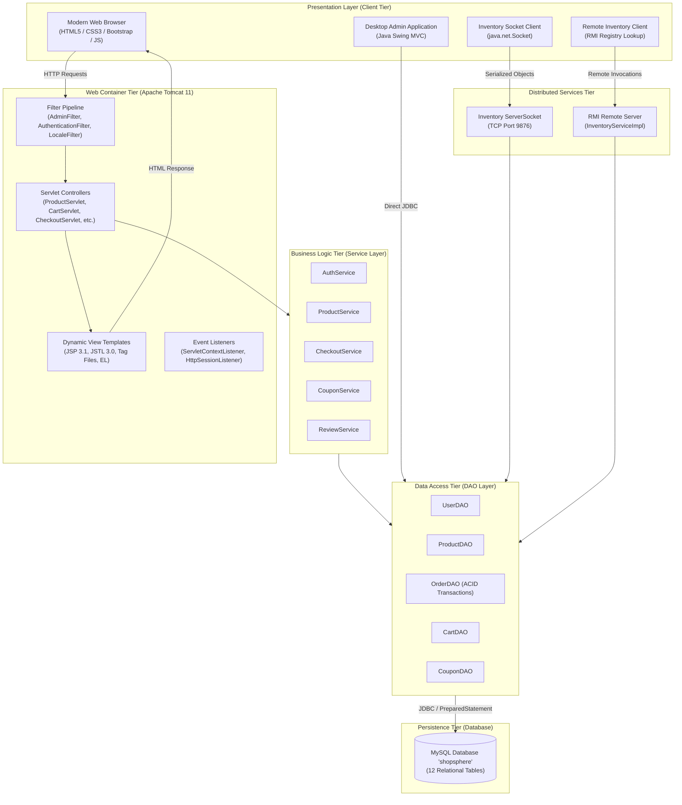
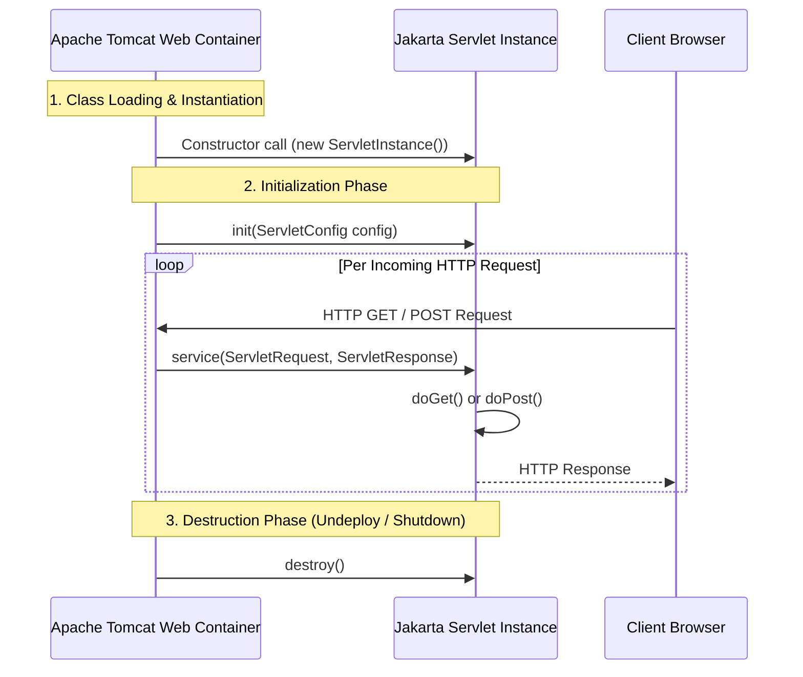

# ShopSphere - System Architecture & N-Tier Engineering

This document outlines the architectural specifications for the **ShopSphere** E-Commerce platform per the RTU Advanced Java / J2EE syllabus.

---

## 1. High-Level Enterprise Architecture

---

## 2. N-Tier Layered Architecture Breakdown

| Layer | Component | Responsibility |
|---|---|---|
| **Tier 1: Presentation** | JSP, JSTL, Tag Files, EL, Bootstrap 5 | Renders UI, extracts attributes from request scope, displays internationalized text. No business logic in JSP. |
| **Tier 2: Controller** | Jakarta Servlets (`@WebServlet`) | Intercepts HTTP requests, reads request parameters, invokes appropriate service, forwards/redirects response. |
| **Tier 3: Service** | Service Classes (`com.shopsphere.service`) | Contains core business rules: coupon discount computation, form validation, cart calculations. |
| **Tier 4: DAO / Data Access** | DAO Classes (`com.shopsphere.dao`) | Encapsulates all SQL queries using `java.sql.PreparedStatement`. Manages ACID transactions via `setAutoCommit(false)`. |
| **Tier 5: Database** | MySQL 8.0+ (`shopsphere`) | Relational persistence across 12 normalized tables with foreign keys and indexes. |

---

## 3. Servlet Lifecycle Explained (For Viva)

1. **Loading & Instantiation:** Tomcat loads the Servlet class and creates an instance upon first request (or on startup if `loadOnStartup` is configured).
2. **`init(ServletConfig)`:** Invoked exactly once to initialize resources (reading context/config parameters).
3. **`service(req, resp)`:** Dispatches incoming requests to `doGet()`, `doPost()`, etc. executed on separate worker threads.
4. **`destroy()`:** Invoked when Tomcat shuts down or undeploys the web application to release open connections and memory.

---

## 4. Security & Filter Pipeline

- **AuthenticationFilter:** Intercepts protected customer routes (`/cart`, `/checkout`, `/orders`, `/wishlist`, `/profile`). Verifies presence of a valid `HttpSession` with an authenticated `User` object.
- **AdminFilter:** Intercepts `/admin/*` endpoints and verifies that `user.isAdmin()` returns true (`role == 'ADMIN'`). Unauthenticated access triggers redirect to login, while unauthorized non-admins receive HTTP 403 Forbidden.
- **SQL Injection Prevention:** All SQL queries strictly use parameterized `PreparedStatement` with `?` placeholders. No string concatenation of user input is permitted.
- **Password Protection:** Passwords are never stored in plain text or cookies. Passwords undergo PBKDF2-HMAC-SHA256 salted hashing before persistence.
