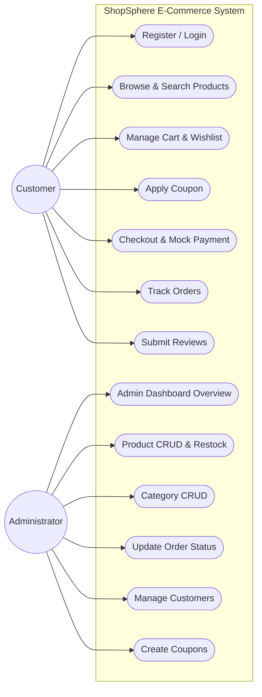
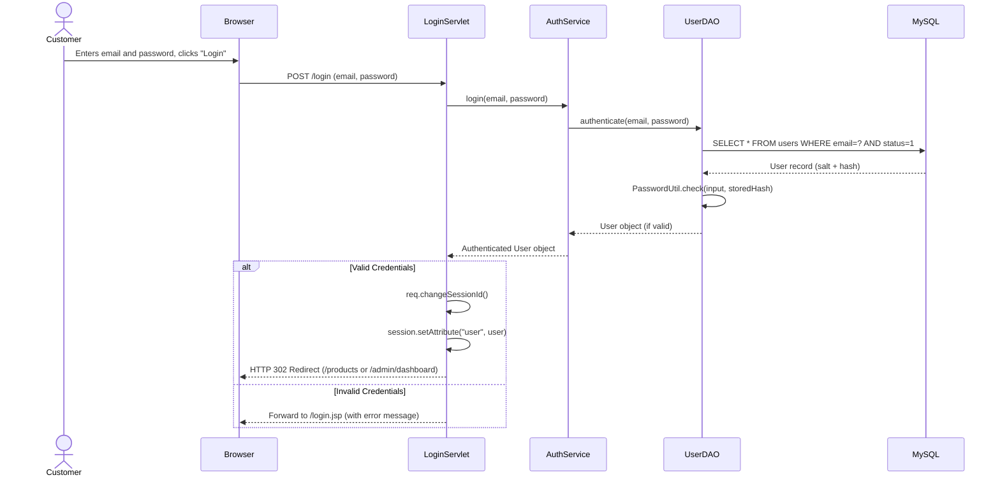
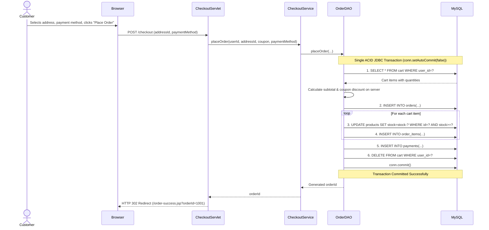
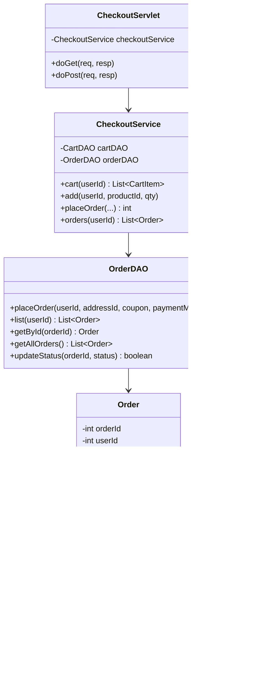

# ShopSphere - UML Diagrams (Use-Case, Class & Sequence)

This document contains standard UML diagrams for the **ShopSphere** RTU Advanced Java project report.

---

## 1. Use-Case Diagram

---

## 2. Sequence Diagram: Customer Login Authentication

---

## 3. Sequence Diagram: Order Placement with ACID Transaction

---

## 4. Class Diagram

