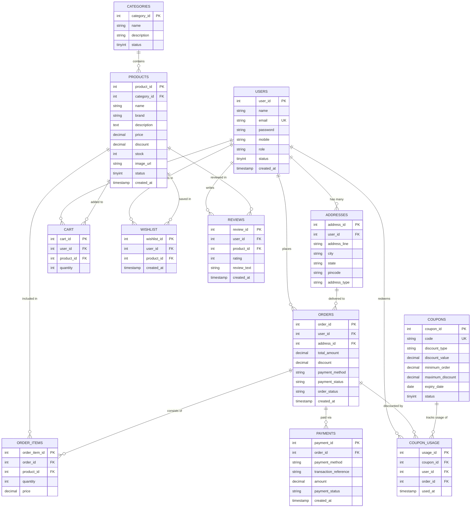

# ShopSphere - Entity Relationship (ER) Diagram

This document describes the complete 12-table database schema designed for the **ShopSphere** E-Commerce platform per the RTU Advanced Java project specifications.

---

## Database Integrity & Security Rules
1. **Normalized Architecture:** Designed up to Third Normal Form (3NF) to eliminate redundant storage and anomalies.
2. **Foreign Key Cascades:** User accounts securely cascade deletions to cart, wishlist, and reviews, while orders maintain archival integrity.
3. **Atomic Inventory Check:** During checkout, `UPDATE products SET stock = stock - ? WHERE product_id = ? AND stock >= ?` ensures zero overselling across concurrent sessions.
